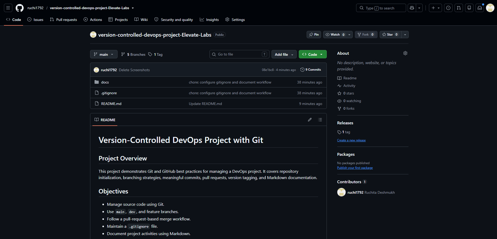
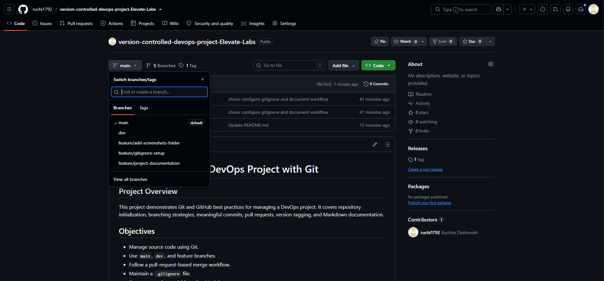
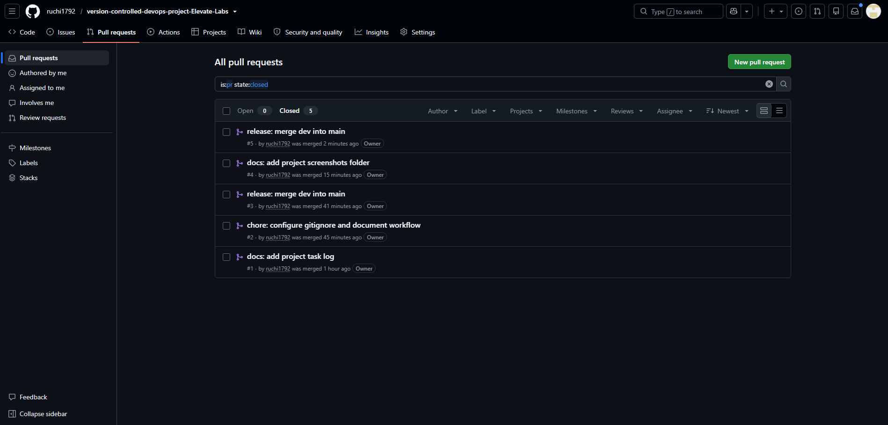
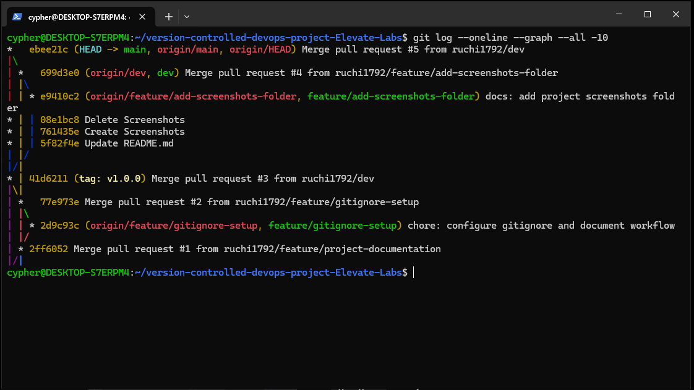
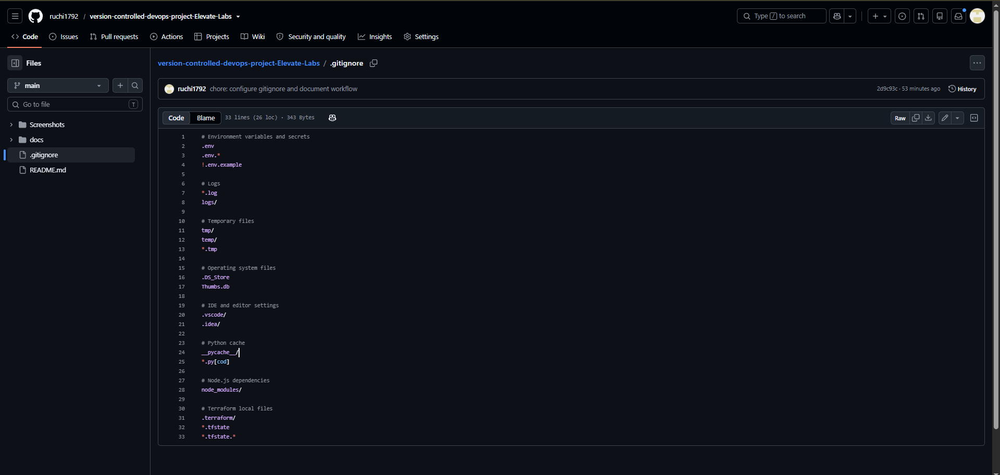
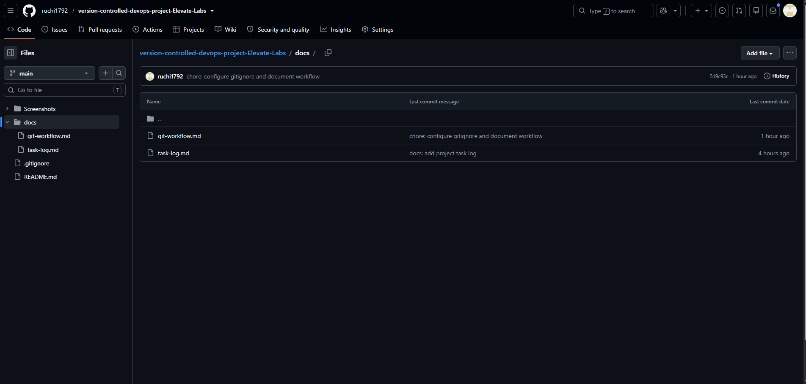
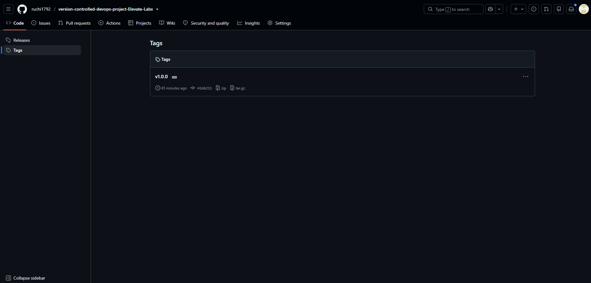
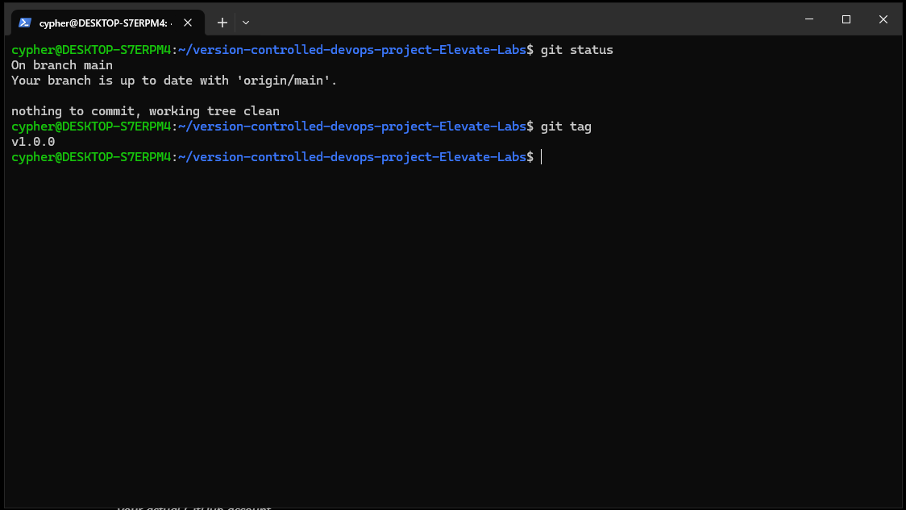

# 🚀 Version-Controlled DevOps Project with Git & GitHub

<p align="center">
  
  
  
  
</p>

## 📌 Project Overview

This project demonstrates how to manage a DevOps project using **Git and GitHub best practices**. It covers repository management, branching strategies, meaningful commits, pull requests, merge workflows, `.gitignore` configuration, Markdown documentation, and release tagging.

The goal is to maintain a structured, traceable, and collaborative development workflow.

## 🎯 Objectives

- 📁 Initialize and manage a Git repository.
- 🌿 Create and manage `main`, `dev`, and feature branches.
- 🔀 Use GitHub Pull Requests to review and merge changes.
- 📝 Maintain meaningful commit messages.
- 🚫 Configure `.gitignore` for unnecessary and sensitive local files.
- 📚 Document tasks and workflows using Markdown.
- 🏷️ Create and publish an annotated Git release tag.
- 📸 Capture project implementation evidence.

## 🛠️ Technologies Used

| Tool | Purpose |
|---|---|
| Git | Version control and commit history |
| GitHub | Remote repository and pull requests |
| Ubuntu on WSL | Linux development environment |
| Markdown | Project documentation |
| Git tags | Release versioning |

## 🌳 Branching Strategy

```text
main
 └── dev
      ├── feature/project-documentation
      ├── feature/gitignore-setup
      ├── feature/add-screenshots-folder
      └── feature/add-project-screenshots
```

- 🟢 **`main`** — Stable project branch.
- 🔵 **`dev`** — Integration branch for reviewed changes.
- 🧩 **`feature/*`** — Separate branches for individual tasks.

Feature branches are merged through Pull Requests. The development branch is then merged into `main` through a release Pull Request.

## ⚙️ Project Workflow

1. 📥 Created a GitHub repository and cloned it locally.
2. 🌿 Set up development and feature branches.
3. ✍️ Added project documentation and meaningful commits.
4. 🚫 Configured `.gitignore` rules.
5. ☁️ Pushed feature branches to GitHub.
6. 🔍 Created and reviewed Pull Requests.
7. 🔀 Merged approved changes into `dev` and `main`.
8. 🏷️ Created and pushed the annotated `v1.0.0` tag.
9. 📸 Added screenshots as project evidence.

## 📸 Project Screenshots

The following evidence is stored in the [`Screenshots/`](Screenshots/) directory.

### 1️⃣ GitHub Repository



### 2️⃣ Git Branches



### 3️⃣ Merged Pull Requests



### 4️⃣ Git Commit History



### 5️⃣ `.gitignore` Configuration



### 6️⃣ Task Documentation



### 7️⃣ Release Tag — v1.0.0



### 8️⃣ Final Verification



## 💻 Useful Git Commands

```bash
# Clone the repository
git clone https://github.com/ruchi1792/version-controlled-devops-project-Elevate-Labs.git

# Check repository status
git status

# List branches
git branch -a

# Switch to the development branch
git switch dev

# Create a feature branch
git switch -c feature/my-change

# Stage and commit changes
git add .
git commit -m "docs: describe project changes"

# Push a feature branch
git push -u origin feature/my-change

# Review commit history
git log --oneline --graph --all

# List release tags
git tag
```

## 📚 Project Documentation

- 📖 [Git Workflow](docs/git-workflow.md)
- ✅ [Task Log](docs/task-log.md)
- 📸 [Project Screenshots](Screenshots/)

## 🏷️ Release Information

- **Version:** `v1.0.0`
- **Release type:** Initial project release
- **Release tag:** `v1.0.0`
- **Branch:** `main`

## 🎓 Key Learnings

- Understanding Git branching and merging.
- Managing remote repositories with GitHub.
- Using Pull Requests for controlled integration.
- Maintaining a readable commit history.
- Excluding unnecessary files with `.gitignore`.
- Documenting technical work using Markdown.
- Applying Git tags for release identification.

## 👩‍💻 Author

**Ruchita Deshmukh**

Cloud & DevOps Enthusiast

🔗 [GitHub Profile](https://github.com/ruchi1792)

---

⭐ If you find this project useful, feel free to explore the repository and its documentation.
